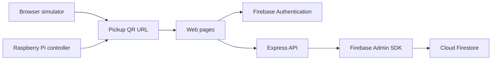

# Smart Courier Box

A team project exploring secure parcel delivery through a web application, a browser simulator and a Raspberry Pi controller.

## What is included

- Firebase sign-in and authenticated API requests.
- Recipient profile and parcel history pages.
- Administrative box creation, deletion and fault reporting.
- QR-based pickup page and browser delivery simulator.
- Python camera, QR scanning, button and actuator controller.

This repository is a prototype. Hardware, cloud configuration and end-to-end delivery must be verified in the target environment before production use. Configure the simulator and Raspberry Pi URLs for your deployment.

## Architecture



The Python controller and simulator are separate components. This diagram does not imply that the hardware is already connected to the Express API.

## Repository layout

| Path | Purpose |
| --- | --- |
| `public/` | Web pages and shared authentication helper |
| `server/src/` | Express API, Firebase configuration and middleware |
| `server/src/__tests__/` | API and utility tests |
| `api/index.js` | Vercel entry point exporting the Express app |
| `sim/public/` | Browser simulator |
| `py/app.py` | Raspberry Pi controller |
| `py/dev/` | Camera and QR diagnostic scripts |
| `py/setup/` | Hardware installation instructions and dependencies |

## Local setup

Use Node.js 22 or later with npm.

1. Clone this repository and open the repository root.
2. Copy `.env.example` to `.env` and supply your Firebase values.
3. Enable Email/Password sign-in in Firebase Authentication and create a Firestore database.
4. Install and start the server:

```sh
npm ci
npm start
```

Open `http://localhost:8080`. The default page is `register.html`. Available pages include `/profile`, `/history`, `/admin` and `/qr`.

The service account must belong to the same Firebase project as the web app. Keep its private key on the server. Admin-only operations require an appropriate role. Never include real service account files in commits.

Startup now fails clearly if Firebase Admin credentials are missing. Tests use an isolated mock; do not run a deployment with NODE_ENV=test.

## Checks

```sh
npm run build
npm test
```

`build` checks server, browser, simulator and inline JavaScript syntax; this project has no frontend bundling step. Jest tests use mocked Firebase token verification and database responses while exercising the real authentication middleware. They do not prove live Firebase or hardware behaviour. Never deploy with `NODE_ENV=test`.

## Browser simulator

Open `/simulator/` on the Express server. Update `sim/public/config.js` to set the deployment origin, four-digit postcode, box serial and code lifetime. Camera access requires localhost or HTTPS and browser permission.

## Raspberry Pi

See [installation instructions](py/setup/INSTALLATION.md). Review wiring and actuator settings before running the controller. Hardware was not validated by the automated Node.js tests.

## Vercel deployment

The actual serverless entry point is `api/index.js`. `vercel.json` routes requests to that handler, and Express serves the files under `public/`.

Configure the variables from `.env.example` in Vercel. Root production dependencies include Express and Firebase Admin. `npm ci` uses the committed root lockfile. Validate file inclusion and environment variables in a preview deployment before production rollout. Use the same Firebase project for the browser and server. Missing credentials stop startup rather than silently using an empty database.

## Known limitations

- Email notifications and cloud-to-hardware integration need end-to-end verification.
- `/data` redirects to `/history`.
- Profile/history identifiers accept either UID or email through one canonical handler.
- Pickup URLs use Base64 encoding, which is not encryption or proof of authorization.
- Browser email sending uses EmailJS templates; configure PUBLICKEY, EMAILJS_SERVICE_ID, EMAILJS_PICKUP_TEMPLATE_ID and EMAILJS_REGISTRATION_TEMPLATE_ID.

## Original team credits

Riley Baxter, Xu Zhang, Peiyuan Li, Troy Meredith, Marlon Gao and Jiahe Teng.

## Delivery workflow and roles

Register or sign in, scan the recipient email QR in the simulator or device, and open the generated delivery link. Sign in as the recipient or an authorised courier and confirm. The app saves the parcel first and sends the pickup email afterwards. If email sending fails, retry on the same page without creating another record. Reloading the page does not preserve that retry state.

Provision admin or courier roles through trusted Firebase custom claims or the Firestore users document. Profile edits cannot change roles or account identity. Ordinary users can view their own parcel records; couriers can look up only the recipient UID/email.

Simulator and device pickup codes are six random digits, expire after ten minutes, and have no universal master code. The current device flow verifies the locally generated code; it does not synchronise pickup completion to Firestore. Treat this as a prototype, not a production smart-lock security design.

## Verification

GitHub Actions installs from the lockfile, checks JavaScript syntax, runs API tests and compiles the Python controller. Hardware testing and real cloud/email verification remain separate deployment checks. See [deployment checklist](docs/DEPLOYMENT.md).
